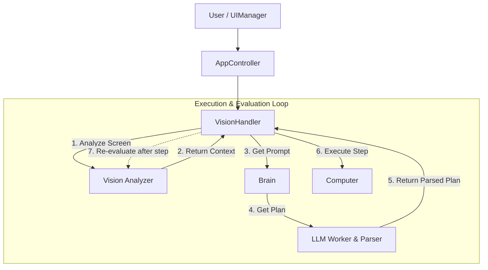
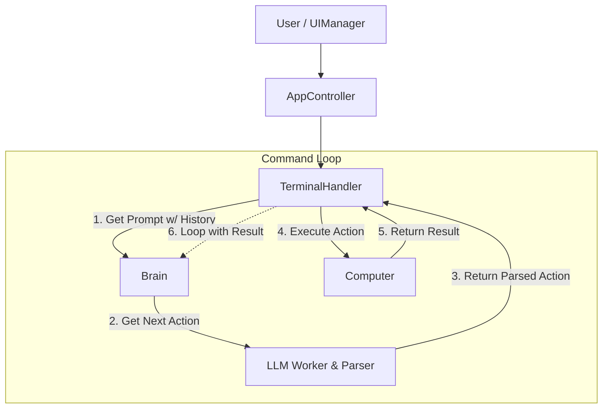
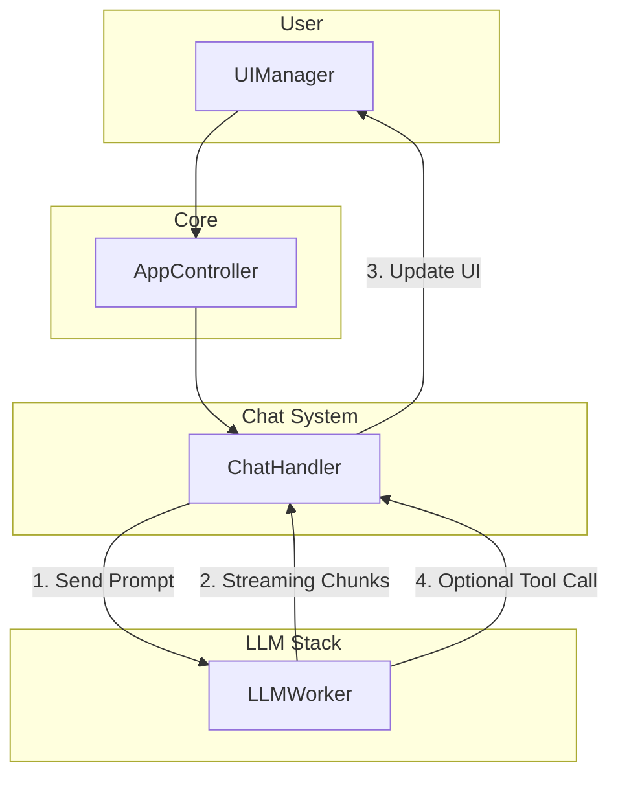

# System Architecture Overview

This document provides a technical overview of the Logos AI Assistant application's architecture. It is intended for developers who want to understand how the system works "under the hood."

## Standard Application Startup

When `settings.json` already exists, the application starts according to the standard scenario, skipping the setup wizard.

1.  **`SettingsManager` Initialization**: The main instance of `SettingsManager` is created, which immediately loads and parses the existing `settings.json`, making all settings available to the rest of the application.

2.  **Dynamic Cache Generation (`ToolRegistry`)**: Immediately after settings are loaded, `ToolRegistry.generate_all()` is called. This key step ensures the modularity of the system:
    *   It reads the "single source of truth" about LLM response structures from `src/llm/schemas.py` and generates `cache/response_formats.json`. This file is used for validating and "repairing" JSON responses from models.
    *   It reads the "single source of truth" about assistant tools from `src/actions.py` and generates several cached files (`strategic_tools.txt`, `tools.txt`, `gemini_tools.py`) based on it, which are used for dynamic prompt generation.

3.  **LLM Provider Configuration Loading**: The system performs a complex process of discovering and configuring all available LLM providers. It dynamically finds all provider classes, collects their base settings, and then enriches them with up-to-date model lists from `models.json`.
    *   This process is described in detail in the document: [**Architecture: Dynamic LLM Provider Loading**](./llm_provider_loading_flow.md).

4.  **`AppController` Creation and UI Launch**: The main application controller is initialized, and the user interface is immediately displayed to ensure a quick start.

5.  **Background Vision Module Initialization**: To keep the UI responsive, the "heaviest" part—loading computer vision models (`OmniParser`)—is performed in a separate background thread (`VisionWorker`). While the models are loading, the "vision mode" button is inactive. As soon as loading is complete, the button becomes available, and the application is fully ready for operation.

---

## System Architecture

### Overall Architecture (The Big Picture)

To ensure reliable and predictable interaction with the LLM ("Brain") at each stage of this cycle, all prompts are built according to strict rules. A detailed description of these standards can be found in the document: [**Prompt Standardization Guide**](./prompt_guidelines.md)

The system is built on a modular architecture, where each component performs its clearly defined role. Below are the data flow diagrams for each of the three main operating modes.

### Data Flow: Vision Mode

This is the most complex mode, encompassing the full cycle of "Planning -> Execution -> Evaluation -> Correction."



**Flow Description:**
1.  **User Input (`UIManager`)**: The user enters a command.
2.  **Central Controller (`AppController`)**: Receives the command and passes it to `VisionHandler`.
3.  **Screen Analysis**: `VisionHandler` initiates asynchronous screen analysis (`VisionAnalyzer`) to get the context.
4.  **Strategic Planning**: Based on the goal and screen context, `brain.py` assembles a prompt for the LLM, which returns a complete step-by-step plan.
5.  **Execution and Evaluation**: `VisionHandler` executes each step of the plan using `Computer`. After each action, it re-analyzes the screen to evaluate the result and, if necessary, corrects its actions.

A detailed description of this mechanism can be found in the document: [**Intelligent Self-Correction Architecture**](./self_correction_architecture.md).

### Data Flow: Terminal Mode

This mode operates as an iterative agent without prior planning. The "thought -> action" cycle repeats until the goal is achieved.



**Flow Description:**
1.  **Prompt Assembly**: `TerminalHandler` calls `brain.py` to create a prompt that includes the original goal and the history of already executed commands.
2.  **LLM Request**: `LLMWorker` sends the prompt and requests a single action (tool call) in response.
3.  **Execution**: `TerminalHandler` receives the validated command and executes it using `Computer` (e.g., `execute_shell`).
4.  **Feedback and Repetition**: The execution result is added to the command history, and the cycle repeats from step 1 until the LLM calls the `finish` tool.

### Data Flow: Chat Mode

This is the simplest mode, optimized for fast, streaming communication.



**Flow Description:**
1.  **Streaming Request**: `ChatHandler` sends the prompt to `LLMWorker` to get a streaming response.
2.  **Real-time Display**: As soon as the first chunks of the response arrive, `LLMWorker` immediately forwards them to `ChatHandler`, which updates the UI, creating the effect of "typing" text.
3.  **Tool Handling (Optional)**: If the model decides to use a tool during response generation (e.g., `web_search`), `LLMWorker` can process this call, get the result, and return it to the model to continue generation—all within a single stream.
4.  **Completion**: When the stream finishes, `ChatHandler` finalizes the message in the UI and saves the complete response to the dialogue history.

---

### Modular Tool Architecture

The tool architecture is modular and scalable. The system uses dynamic tool loading by mode.

This separation ensures a cleaner codebase, where each tool has its defined place, and allows the application to load only the set of tools necessary for the current task (Chat, Terminal, or Assistant).

#### 1. New File Structure

-   **`src/computer/tools/`**: This is the root directory for all tool functions. They are grouped by categories:
    -   `vision/`: Tools for interacting with the GUI (e.g., `click`, `write_text`).
    -   `terminal/`: Tools for working with the file system and command line (e.g., `execute_shell`, `read_file`).
    -   `web/`: Tools for interacting with web resources (e.g., `web_search`). A detailed explanation of the hybrid search model can be found in [**this guide**](./hybrid_web_search_guide.md).
    -   `common/`: Tools used in multiple modes (e.g., `finish`).
-   **Isolated Files**: Each tool function resides in its own file (e.g., `src/computer/tools/vision/click.py`).
-   **`src/computer/tools/constants.py`**: Common constants (e.g., `KEYBOARD_KEYS`) are moved to a separate file.

#### 2. Mode "Manifests"

-   **`src/computer/modes/`**: This directory contains "manifests" for each operating mode (`chat.py`, `terminal.py`, `vision.py`).
-   **Purpose**: Each manifest file imports the necessary tool functions from `src/computer/tools/` and collects them into a `TOOLS_METADATA` dictionary. This dictionary serves as the "single source of truth" about which tools are available in a given mode.
-   **Metadata**: The `@tool_meta` decorator now attaches metadata (description, arguments) directly to the tool function itself, allowing `ToolRegistry` and `Computer` to easily read them.

#### 3. Dynamic Loading into `Computer`

-   **`src/computer/computer.py`**: This class has been significantly simplified. It no longer contains tool function definitions.
-   **`_load_mode_tools` Method**: When initializing `Computer` with a specific mode (e.g., `'terminal'`), this method:
    1.  Dynamically imports the corresponding manifest module (e.g., `src.computer.modes.terminal`).
    2.  Reads the `TOOLS_METADATA` dictionary.
    3.  Dynamically "binds" each tool function from the manifest as a method to the current `Computer` instance.

#### 4. Mode Management in `AppController`

-   **`src/controller.py`**: The main controller manages the `Computer`'s lifecycle.
-   **Initialization**: On startup, `AppController` creates a `Computer` instance in the default mode (`'chat'`).
-   **Mode Switching**: When the user switches the mode in the UI (e.g., to "Terminal"), `AppController` calls the internal method `_switch_computer_mode('terminal')`.
-   **New Instance Creation**: This method creates a **new** `Computer` instance with the specified mode. The new instance automatically loads the correct set of tools. This ensures that `VisionHandler` and `TerminalHandler` always work with a current and correct set of tools.

#### 5. Cache Generation in `ToolRegistry`

-   **`src/tool_registry.py`**: `ToolRegistry` files responsible for generating cache files with tool descriptions and return data for their validation.
-   **Process**: When generating the cache (`strategic_tools.txt`, `gemini_tools.py`, etc.) for a specific mode, `ToolRegistry` now:
    1.  Dynamically imports the manifest module for that mode.
    2.  Extracts metadata directly from the functions listed in `TOOLS_METADATA`.


### Startup Optimization: Background Model Loading

To ensure the fastest possible application startup and UI responsiveness, the most "heavy" components, such as the `OmniParser` neural network model, are initialized in a separate background thread.

-   **Instant Start**: The user interface (UI) loads and displays immediately, without delays.
-   **Parallel Loading**: Immediately after the UI appears, the system starts a background task to prepare the computer vision module.
-   **Full Readiness**: While models are loading, the main chat functionality is already available. Vision mode, which requires screen analysis, becomes fully functional automatically as soon as background loading is complete.

This approach avoids the application "freezing" at startup and improves the overall user experience.

---

### Unified Asynchronous Screen Analysis

In addition to background model loading at startup, the system also uses multithreading for all key screen analysis operations (both during initial **planning** and **evaluation** of executed actions). This keeps the interface fully responsive, even when resource-intensive computer vision tasks are being performed.

-   **Logic Source**: `src/handlers/vision_handler.py` (initiation) and `src/vision/analyzer_worker.py` (execution).
-   **Process**:
    1.  **Instant Screenshot**: When the assistant needs to understand what is on the screen (`PLANNING` or `EVALUATING`), `VisionHandler` first takes a "clean" screenshot in the main thread. This is a fast operation.
    2.  **Delegation to Background**: The screenshot is passed to `AnalyzerWorker`, which moves to a free thread managed by the central `ThreadPool`.
    3.  **Parallel Operation**: While `OmniParser` analyzes the image in the background thread, the main thread remains free. The UI does not "freeze" and can display the current status ("Analyzing screen...", "Evaluating...").
    4.  **Safe Result Return**: Upon completion of the analysis, `AnalyzerWorker` sends the result (parsed UI elements) back to `VisionHandler` via a single Qt signal (`analysis_complete`).
    5.  **Dispatch**: `VisionHandler` receives the result and, depending on its current state (`state`), directs it to the appropriate method for further processing (continuing planning or completing evaluation).

This unified approach is critically important for the user experience, as it eliminates any interface delays at moments when the user expects a reaction from the system.

---

### State Management (Finite State Machine)

The entire logic of the assistant is built on a finite state machine, which makes its behavior predictable and manageable. States are defined in the `src/states.py` file.

-   **`ControllerState`**: Defines the global state of the application (`IDLE`, `CHATTING`, `TERMINAL`, `VISION`).
-   **`VisionState`**: Defines the micro-state within the assistant's mode. `VisionHandler` constantly switches between these states:
    -   `PLANNING`: Initial plan creation.
    -   `WAITING_FOR_APPROVAL`: Waiting for user approval of the plan.
    -   `EXECUTING`: Physical command execution.
    -   `EVALUATING`: Evaluation of the execution result.
    -   `WAITING_FOR_ELEMENT`: Pause to wait for a long operation to complete.
    -   `FINDING_WAIT_ORIGIN`: Searching for the cause of unexpected waiting.
    -   `EXPLAINING_ERROR`: Generating an explanation in case of an unresolvable error.
    -   `PAUSED`: Temporary pause by user command.
    -   `PAUSED_ON_ERROR`: Pause due to an unresolvable error, awaiting user assistance.

---

### Preventing Self-Occlusion

One of the key problems of any screen assistant is the risk that its own interface might overlap the target element to be clicked. Our system solves this problem with an "intelligent" and cross-platform avoidance mechanism.

-   **Logic Source**: `src/handlers/vision_handler.py` (when to move) and `src/ui/manager.py` (how to move).
-   **Problem**: Standard Qt methods (`geometry()`, `frameGeometry()`) proved unreliable for determining the actual screen coordinates of a compact window in Windows when it uses the `Qt.Tool` flag. This led to the system incorrectly assessing its window's position and not moving it, even when it overlapped the target.
-   **Solution (Cross-Platform Approach)**:
    1.  **Pre-click Check**: Before performing an action (`click`, `double_click`), `VisionHandler` calculates the target's center point.
    2.  **OS-Specific Collision Detection**: `UIManager.is_click_colliding` performs an OS-specific check:
        -   **For Windows**: Uses a direct call to the native Windows API function (`GetWindowRect` via `ctypes`) to get precise, physical window coordinates on the screen. This ensures that we get the same data the system uses for click processing.
        -   **For Linux and macOS**: Uses the standard Qt method `frameGeometry()`, which works correctly on these systems.
    3.  **Instant Movement**: If a collision is detected, `UIManager` **instantly** (without animation) moves the compact window to the opposite side of the screen (from bottom to top or vice versa).
    4.  **Action Execution**: Immediately after moving the window, `VisionHandler` performs the click on the now accessible target.
    5.  **Position Stability**: The window remains in its new position until the next collision occurs.

This hybrid mechanism ensures that the assistant never interferes with itself, maintaining reliability on Windows and cross-platform compatibility.

---

### Interactive UI Components: CollapsibleBlock

To maintain the cleanliness and readability of the chat log, especially when working with tools that generate a large amount of text output (e.g., `read_file`, `web_search`, `run_shell_command`), the system implements a `CollapsibleBlock` component (accordion). It allows hiding voluminous content, providing the user with the option to expand it on demand.

-   **Purpose**: Hiding large text outputs from tools such as `read_file`, `read_many_files`, `web_search`, `web_fetchs`, `run_shell_command`, `search_file_content`.
-   **How it Works**:
    1.  **Data Formulation**: Instead of direct HTML, handlers (e.g., `src/handlers/terminal_handler.py`) send a structured dictionary to the UI.
    2.  **UI Processing**: `ChatWidget` intercepts these dictionaries, manages the `is_collapsed` state for each block, and generates corresponding HTML with interactive `<a>` links to toggle the state.
    3.  **Interactivity**: Clicking on a `toggle:unique_id:state` link is intercepted by `ChatWidget`, which updates the state and redraws the block.
-   **Data Structure for UI**:
    To create a collapsible block, the handler must send a dictionary with the following structure to the UI:
    ```python
    {
        "type": "collapsible_block",
        "content": "Content that will be hidden/shown.",
        "title": "Block title (e.g., 'Output of read_file: /path/to/file.txt')",
        "is_collapsed": True # Initial state: True for collapsed, False for expanded
    }
    ```
-   **Key Components**:
    -   `src/ui/widgets/collapsible_block_formatter.py`: Responsible for generating HTML for `CollapsibleBlock`, ensuring its reusability and theme compliance.
    -   `src/ui/widgets/chat_widget.py`: The main chat widget that processes incoming structured data, manages the state of collapsible blocks, and responds to `toggle:` link clicks.
    -   `src/handlers/terminal_handler.py`: An example handler that has been updated to send structured dictionaries to the UI for tools with large outputs.

This mechanism ensures flexibility and UI cleanliness, allowing the user to control the amount of information displayed.

---

### Dynamic OCR Language Loading and Management

The system allows the user to flexibly manage OCR (Optical Character Recognition) languages directly from the settings menu, without needing to restart the application. This functionality addresses several key tasks to ensure convenience and reliability.

-   **Background Loading with Indication**: When selecting languages for which models have not yet been downloaded, the application automatically initiates their download. Instead of a percentage indicator, an **indeterminate dialog** is used, which shows a text status (`"Downloading model..."`, `"Download complete. Finalizing..."`). This was made possible by intercepting and analyzing the standard output of the `easyocr` library, which provides reliable feedback to the user without direct access to the downloader API.

-   **Intelligent Dependency Management**: The interface automatically handles the complex compatibility rules of `easyocr` models. For example:
    *   When selecting any Cyrillic language (Russian, Ukrainian), the system will automatically add and lock English, as the Cyrillic model is trained to recognize both alphabets and requires their joint inclusion for correct operation.
    *   When selecting a language from a "dominant" group (e.g., Japanese or Arabic), the interface will automatically deselect incompatible languages (e.g., German or French), preventing configuration errors before they occur.

-   **Reliable Initialization**: The system has been optimized for correct operation with `easyocr`. Instead of complex "workarounds" with pre-loading, a single direct call is now made for initialization, ensuring fast and error-free loading of the desired language model.

A detailed explanation of the rules for selecting compatible language models can be found in the [**corresponding guide**](./easyocr_language_model_guide.md).

---

### Cross-Platform Application Handling

The system is designed to work on different operating systems (Windows, macOS, Linux). This is achieved by abstracting OS-dependent functionality into specialized modules.

-   **Scanning Installed Applications (`src/apps/installed_apps.py`)**:
    -   **Source**: An external library `app-scanner` is used, which can find installed programs in the standard directories of each OS.
    -   **Process**: `AppScanner` returns a list of applications, where each is represented by a dictionary. Importantly, the application identifier depends on the platform:
        -   **Windows**: `appid` (unique identifier for Shell).
        -   **macOS/Linux**: `path` (path to the `.app` bundle or executable).
    -   **Caching**: Scan results are saved to `cache/app_cache.json` to avoid repeated checks on every launch. The cache is updated only by clicking the "Scan for Applications" button in the settings.

-   **Launching Applications (`src/apps/launcher.py`)**:
    -   **Source**: The new `CrossPlatformAppLauncher` module encapsulates all launch logic.
    -   **Process**:
        1.  `VisionHandler` creates an instance of this launcher.
        2.  When the LLM generates a `launch_app` command, `actions.py` calls the `launcher.launch()` method, passing it a complete dictionary of application information.
        3.  `CrossPlatformAppLauncher` determines the current OS and uses the appropriate command:
            -   **Windows**: `explorer.exe shell:Appsfolder\{appid}`
            -   **macOS**: `open <path>`
            -   **Linux**: `xdg-open <path>`
    -   **Reliability**: Instead of vague name-based searching, the system now uses exact (case-insensitive) matching of the application name from the list provided by the LLM. This eliminates the risk of launching the wrong program.

This approach allows the core assistant logic (`VisionHandler`, `actions.py`) to remain platform-independent, delegating specific tasks to modules in `src/apps/`.

---

### Reliable Handling of Structured LLM Responses

The cornerstone of the assistant's reliability is its ability to receive and understand structured data (plans, evaluations) from the LLM. We do not blindly trust the LLM, but use a multi-level system of validation, repair, and conscious choice of architectural approaches for handling responses.

#### Philosophy: JSON is a Contract

Any structured response from the LLM is treated as a contract that must conform to a clearly defined schema.

-   **`src/computer/schemas`**: This is the **"Single Source of Truth"**. It defines the structure of all expected responses using Pydantic models.
-   **`src/tool_registry.py`**: On startup, generates the `cache/response_formats.json` file from Pydantic models. This file contains JSON schemas and examples that are used both for prompt formulation and for validation.

#### Multi-Level Protection and Repair System

Our system uses a multi-level approach to ensure maximum reliability when working with LLM responses.

1.  **"Smart Repair Workshop" (`llm_parsing.py`)**: This is the first line of defense. It uses a hierarchical approach with several levels of protection to correct syntactically incorrect or incomplete JSON responses:
    -   **Priority 1 (Strategic Plan Search):** First, the parser searches the response for a complete strategic plan. This allows correct handling of situations where the model, in response to an evaluation request, decides to completely re-plan its actions.
    -   **Priority 2 (Standard Evaluation Repair):** If no plan is found, the parser searches for a standard, correctly nested evaluation structure (`evaluation` and `next_move`). At this stage, it can also correct minor typos in key fields (e.g., `statis` instead of `status`).
    -   **Priority 3 (Flat Evaluation Repair):** If this also fails, the last line of defense is activated. The parser searches for `status` and `next_move` keys at the top level of the response. If found, it independently assembles a correct nested structure from them, adding missing mandatory fields (e.g., `reason`) with default values.
    -   **Priority 3.1 (Adding Missing `type`):** If the LLM response contains a `payload` key but the top-level `type` key is missing, the parser automatically adds `type` with the corresponding `schema_name`. This prevents incorrect double wrapping of the `payload` and improves the handling of "almost correct" responses.
    -   **Priority 4 (Intelligent Extraction from Unformatted Responses):** If the response is not valid JSON, the system activates a multi-level parser that operates on the **"Content-First"** principle. Instead of relying on strict tag structure, it intelligently searches for familiar entities directly in the response text.
        *   **Search by content, not by structure:** The parser no longer searches for tags named `name` or `action`. Instead, it searches the text for **direct mention of valid tool names** (e.g., `click`, `web_fetchs`, `finish`). This makes it immune to how the LLM decides to wrap its response.
        *   **Unified Tool Knowledge Base:** The parser dynamically collects a complete list of all available tools from **both operating modes** ("Terminal" and "Assistant"). This ensures that it can recognize any legitimate command, regardless of context.
        *   **Robustness to Formatting Errors:** The argument extraction logic has been improved and is now capable of correctly handling common errors such as **unclosed XML tags**, which significantly increases the chances of successful data recovery from messy responses.
        
        This approach transforms the parser from a simple "JSON repairman" into an intelligent mechanism that can understand the LLM's *intention*, even if its *form* is imperfect.

2.  **"Second Chance" Mechanism (Self-Correction in `llm_worker.py`)**: If all automatic repairs in `llm_parsing.py` have failed and the response still does not conform to the schema, a second, more powerful line of defense comes into play.
    -   **Trigger**: Unsuccessful validation in `llm_worker.py`.
    -   **Process**:
        1.  The worker intercepts the detailed validation error from Pydantic.
        2.  It calls `brain.py` to assemble a special "correction" prompt.
        3.  This prompt contains: the original request, the invalid JSON, the detailed validation error, and an example of the correct structure.
        4.  The new prompt is sent to the LLM with a direct task: "Correct this JSON."
    -   **Result**: This mechanism allows the LLM to "see" its error and correct it, significantly increasing the chances of getting a correct structured response even after an initial failure. Only if the second attempt also fails, the system reports the error to the user.

#### Intelligent Error Handling and Retry Mechanism

To ensure high reliability and provide clear feedback to the user, the assistant implements an intelligent error handling mechanism. It is based on classification and centralized management, which allows effective handling of both temporary glitches and critical configuration problems.

-   **`src/llm/exceptions.py`**: Introduces two main error categories:
    -   **Fatal (`FatalError`)**: Client-side errors that are guaranteed to recur: invalid API key, quota exhaustion, incorrect request (`4xx` errors).
    -   **Retryable (`RetryableError`)**: Problems that may resolve themselves: temporary server-side failures (`5xx` errors) or network connection issues.

-   **Providers (`src/llm/providers/`)**: Each provider is responsible for catching its library-specific errors and "repackaging" them into `FatalError` or `RetryableError`. This makes all subsequent logic independent of the specific provider.

-   **`src/llm/llm_worker.py`**: The **"Fault-Tolerant Dispatcher"** is the central hub of this logic. It runs in a separate thread and:
    1.  Catches these two types of exceptions.
    2.  On `FatalError`, **immediately stops** all attempts and emits an error signal.
    3.  On `RetryableError`, uses a **retry loop** with exponential backoff.

-   **`src/llm/error_formatter.py`**: Generates user-friendly HTML messages based on the error type, which are then displayed in the interface.

This approach saves time and API requests by avoiding meaningless retries under inherently unsuccessful conditions and provides clear feedback on problems that require user intervention (e.g., correcting the API key).

#### Two Strategies for JSON Retrieval: `require_json_output`

The system supports two strategies for retrieving structured data, which are switched by the `require_json_output` parameter in `settings.json` for each LLM provider.

##### 1. Modern Approach (`require_json_output: true`)

This is the preferred method for **structured responses in agent modes** (Terminal: [`terminal_tool_code`](src/computer/schemas/terminal.py); Vision: [`strategic_plan`](src/computer/schemas/vision.py)/[`evaluation`](src/computer/schemas/vision.py)). The LLM generates pure JSON according to a Pydantic schema (without the `tools` API parameter).

**In streaming Chat mode**, providers use **native tool calling** (`tools`=[web_search/web_fetch]) for search tools ([`anthropic_provider.py`](src/llm/providers/anthropic_provider.py), [`google_provider.py`](src/llm/providers/google_provider.py), [`openai_provider.py`](src/llm/providers/openai_provider.py), [`openrouter_provider.py`](src/llm/providers/openrouter_provider.py), [`x-ai_provider.py`](src/llm/providers/x-ai_provider.py)). [`huggingface_provider.py`](src/llm/providers/huggingface_provider.py) is excluded: it sets `supports_streaming_tools: False`, so the worker (`llm_worker.py:495`) takes the legacy text-only streaming path and Chat-mode search tools are unavailable on that provider. This is an implementation gap, not a protocol limitation — the HF router speaks OpenAI-compatible tool calling (documented, incl. function-calling examples), but our `stream_response` never sends the `tools` parameter and yields plain strings instead of typed `text`/`tool_code` chunks. Wiring it up means sending `tools` in the stream request, yielding typed chunks, and flipping the flag.

-   **Why JSON schemas for agents**: Complex structures (plan with tasks, evaluations); Pydantic validation is simpler than adapting to the `tools` API.
-   **Conscious Decision**: Prompt with schema/examples + `response_mime_type='application/json'` (Gemini) / `tool_choice={"type": "function", "function": {"name": schema_name}}` (OpenAI/Anthropic).
-   **Advantages**:
    -   **Reliability**: Eliminates JSON parsing from text (`llm_parsing.py` for repair).
    -   **Simplicity**: Providers are simpler; no string "repair."
    -   **Efficiency**: LLM does not spend tokens on tool format.

##### 2. Fallback Approach (`require_json_output: false`)

This method is used for models that do not support forced JSON output.

-   **Process**:
    1.  **Prompt**: Instructions and examples are included in the system prompt for the LLM to generate a JSON string within its text response.
    2.  **Extraction and Repair**: The provider receives a text response, finds a JSON-like string within it, and passes it to `llm_parsing.py`.
    3.  **Validation**: `llm_parsing.py` attempts to correct syntactic errors (unclosed brackets, extra commas) and convert the string to valid JSON.
-   **Disadvantages**: This method is less reliable and can fail if the LLM generates severely corrupted or incomplete JSON.

#### Extending the System: Adding a New LLM Provider

To add a new LLM provider, you only need to create **one file** in the `src/llm/providers/` directory.

The system will automatically discover it, integrate it into the settings UI, and make it available for use. A detailed step-by-step guide on creating a provider file can be found in the document:
[**Guide: Adding a New LLM Provider**](./adding_new_llm_provider_guide.md).

---

### Dynamic LLM Model Management

To ensure maximum flexibility and relevance, the system does not store lists of available LLM models in the code. Instead, it uses a centralized approach that allows models to be updated without requiring a new application release.

-   **Source of Truth**: On first launch and upon user request, the application downloads the `models.json` file from a remote source. This file contains an up-to-date list of supported providers and their models.
-   **Configuration Manager (`src/llm/model_config_manager.py`)**: This specialized class is responsible for:
    1.  Loading `models.json` when the application starts.
    2.  Caching this file locally in the `cache/` directory.
    3.  Merging the loaded configuration with the base provider structure.
-   **User Control**: In the settings menu, the user can click the "Update Models" button at any time to forcefully download the latest version of `models.json` and immediately see new available models in the interface.

A detailed description of the entire provider loading and configuration process can be found in the document:
[**Architecture: Dynamic LLM Provider Loading**](./llm_provider_loading_flow.md).

---

### Adaptive Self-Correction: "Action-Evaluation" Cycle

The assistant does not simply blindly execute a pre-determined plan. Its operation is based on a continuous **"Action -> Evaluation"** cycle, which allows it to adapt to changing conditions and correct its own errors. This mechanism has two levels:

1.  **Logical Self-Correction**:
    -   **Process**: After each executed action (`src/computer/tools`), the system takes a new screenshot and asks the LLM to evaluate whether the `expected_outcome` has been achieved.
    -   **Example**: If the LLM tried to create a new file using `Ctrl+N`, but did not see an empty file in the new screenshot, it will record `status: failure`. In the next step, it will not just repeat the action, but will try an **alternative strategy** (e.g., use the command palette in the editor) until it achieves the goal.
    -   **Logic Source**: `src/handlers/vision_handler.py`.

2.  **Structural Self-Correction (Learning from Errors)**:
    -   **Problem**: Sometimes, especially when working with less powerful models (e.g., `nano`), the LLM may generate a syntactically correct but incomplete action (e.g., call `hotkey` without specifying the keys themselves).
    -   **Solution**: Instead of causing a crash, the system turns the error into a learning moment. The `src/computer/tools` module intercepts such a call, generates a **detailed error message with an example of the correct format**, and passes it back to the LLM.
    -   **Error Example**: `"Action 'hotkey' failed: The 'keys' argument is missing. Example: {'name': 'hotkey', 'arguments': {'keys': ['ctrl', 's']}}"`
    -   **Result**: The LLM "sees" its error, understands how to fix it, and in the very next step generates a correct action.

This two-level approach makes the assistant extremely robust, allowing it to not only overcome logical impasses but also to learn the correct use of its own tools "on the fly."

More detailed key components of this architecture can be described as follows:

1.  **Failure Escalation Protocol**: This is the core of the system, implemented in `_handle_evaluation_response` (`vision_handler.py`), which allows the assistant to autonomously handle errors:
    *   **Level 1 (`action_correction`):** Tactical correction of action parameters.
    *   **Level 1.1 (Structural Self-Correction):** "On-the-fly learning" thanks to detailed error messages from `actions.py`.
    *   **Level 2 (`insertion_correction`):** Inserting new steps into the plan to handle predictable deviations (e.g., dialog boxes).
    *   **Level 3 (`task_replacement`):** Replacing the current step with an alternative method for achieving the goal.
    *   **Level 4 (`strategic_failure`):** Triggering a complete replanning via `_trigger_strategic_replan`.

2.  **Strategic Replanning**: If tactical fixes are not enough, the `_trigger_strategic_replan` method initiates the creation of a new plan from scratch, using a special contextual prompt from `brain.py`.

3.  **`wait_element` Tool**: A hybrid waiting system that can be both planned and reactive. If the assistant encounters an unexpected load, it launches a "detective" (`_find_wait_origin`) to find the cause and initiate waiting.

---

### Token Economy: Canceling Streaming Requests

To optimize LLM token costs, especially when working with expensive models, the system incorporates an active cancellation mechanism for streaming requests.

-   **Logic Source**: `src/controller.py`, `src/llm/llm_worker.py`, `src/llm/providers/openrouter_provider.py`.
-   **Problem**: When a user interrupts response generation in chat, simply stopping client-side processing does not stop the generation itself on the LLM provider's server. As a result, the user pays for all generated but unused text.
-   **Solution**:
    1.  **ID Retrieval**: For providers that support it (e.g., OpenRouter), the system extracts a unique `generation_id` from the very first message in the data stream.
    2.  **Cancellation Signal**: When the user clicks the "Cancel" button, `AppController` immediately calls the `cancel()` method of `LLMWorker`.
    3.  **Server Request**: `LLMWorker` checks if there is an active `generation_id` and if the current provider supports cancellation. If so, it sends a special `POST` request to the server via the provider (e.g., `OpenRouterProvider`) to stop generation.
    4.  **Local Stop**: Immediately after sending the request to the server, the system interrupts client-side stream processing, ensuring an instant UI response.

-   **Provider Support**:
    -   **Supported**: OpenAI, Anthropic (via OpenRouter).
    -   **Not Supported**: Google Gemini (the API currently does not provide this capability).

This mechanism ensures that when a request is canceled, generation stops not only visually but also physically on the server, which saves costs.

---

### How to Work Correctly with `SettingsManager`

Short rules and examples for the entire project.

Core Principles

- There should be one `SettingsManager` instance in the project, created at the entry point (e.g., in `main.py`). Do not create new instances in other modules.
- Pass the existing `SettingsManager` instance to classes and functions via parameters/constructors (Dependency Injection). Example: `MyClass(settings_manager, controller)`.
- Do not duplicate default value selection logic: use `SettingsManager.DEFAULTS` as the source of truth for default values.
- To read a value, use `settings_manager.get('key', SettingsManager.DEFAULTS['key'])`.
- To write, use `settings_manager.set('key', value)` or `settings_manager.set_many({...})` for batch updates.
- Do not change `SettingsManager.DEFAULTS` at runtime or write directly to the file—use `settings_manager.save()` / `settings_manager.set(...)`.

Subscribing to Changes

- If a module needs reactivity (to update behavior when settings change), subscribe to the Qt signal:

```python
# in __init__ of the class
self.settings_manager = settings_manager
self.settings_manager.settings_changed.connect(self.on_settings_changed)

# handler
def on_settings_changed(self, new_settings: dict):
    # read necessary fields from new_settings or via self.settings_manager.get(...)
    cache_dir = new_settings.get('cache_dir', SettingsManager.DEFAULTS['cache_dir'])
    # apply the updated value
```

- Unsubscribe on cleanup/close (if the class has a long lifespan): `self.settings_manager.settings_changed.disconnect(self.on_settings_changed)`.

Reading and Using Parameters (Minimalism)

- Example of getting the `cache_dir` setting without unnecessary checks:

```python
from src.settings_manager import SettingsManager

active_provider = settings_manager.get('active_provider', SettingsManager.DEFAULTS['active_provider'])
```

Writing Settings

- For a single update:

```python
settings_manager.set('current_model', 'gpt-4o')
```

- For multiple values in one step (and to trigger a single signal):

```python
settings_manager.set_many({'language': 'en', 'current_model': 'gpt-4o'})
```

Order of Actions for Settings Schema Changes

- When adding new fields to `DEFAULTS` in the code, do not break existing installations—the `SettingsManager._load_settings()` logic for filling in missing fields with default values is already implemented.
- For migrations, use centralized code in `SettingsManager._load_settings()`.

Additional Notes

- Do not use direct `settings.json` file reading in other modules—always go through `SettingsManager`.
- If a module does not operate in a GUI context (cannot connect to Qt signals), still use DI and `get(...)`/`set(...)`.
- For consistency, log changes via `settings_manager.set_many(...)`, not manually.

Brief Summary (three lines):
1) One `SettingsManager` in the application, pass it everywhere via DI.
2) Read via `get(..., DEFAULTS['...'])`.
3) For reactivity, subscribe to `settings_changed` and unsubscribe correctly.

---

### User Functions

-   **File Search**: To improve user interaction, a file search function using wildcards with the `@` symbol has been implemented. More about using this function can be found in the [**file search guide**](./file_search_guide.md).