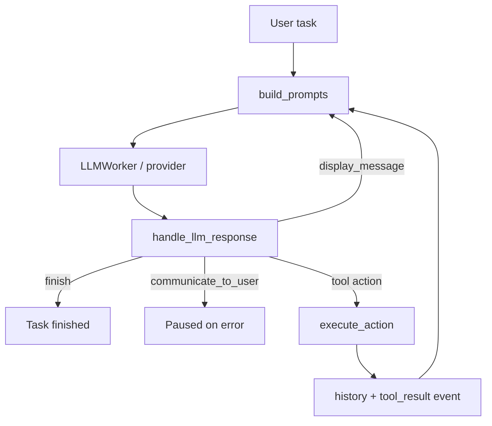

# System Architecture Overview

This document describes how Logos works **today**, as implemented in the repository. It is a developer overview, not a roadmap; planned work lives in [future_vision.md](./future_vision.md).

The application is a PySide6 desktop assistant with four panels — Chat, Terminal, Browser and Vision. A session is not locked to one of them: it holds capabilities (`base` always, plus `terminal`, `browser`, `vision`) and the panel only chooses the presentation. Terminal and Browser are iterative agents built on one shared loop (`BaseAgentHandler`); Vision uses the same loop discipline but is driven by a provider's native Computer Use protocol. Chat is a streaming conversation without a tool loop.

## Startup

`main.py` owns the startup order. The order matters because providers need the model catalog before settings are merged, and the tool cache needs the manifests before the first prompt is built.

1. **Application shell and DPI setup.** `QApplication` is created early so a splash screen covers the remaining startup. On Windows, Per-Monitor V2 DPI awareness is enabled before any window exists, so screenshots, cursor coordinates and Qt geometry all use physical pixels.

2. **Model catalog — `ModelConfigManager.initialize()`** (`src/llm/model_config_manager.py`). This runs before `SettingsManager` is constructed. It merges `SettingsManager.PROVIDER_CONFIG` (built from provider metadata only, see below) with `cache/models.json`, downloaded from `https://aigrator.github.io/LLM-models/models.json` and validated before use. If the file is missing or invalid, built-in fallback model lists are used. The "Update Models" button refreshes the cache without a release.

3. **Settings — `SettingsManager()`** (`src/settings_manager.py`). One instance for the whole process. It loads `settings.json`, fills missing defaults, resolves application directories and reads API keys from the OS keyring. If `settings.json` does not exist, the first-run setup wizard runs and the app exits if it is cancelled.

4. **Project resolution — `ProjectManager`** (`src/project_manager.py`). Startup resolves the remembered `active_project`; a folder passed on the command line wins and is registered as a project. If none is available, the UI opens the full-screen `HomePage` instead of a modal picker. The project root becomes the terminal/browser working directory, the file-index root and the owner of the `.logos` data folder. With `prevent_multiple_instances` on, a second launch forwards `open_project:<folder>` over the `Logos-Assistant-Lock` local socket to the running process and exits, so "Open with Logos" switches the existing window to that project instead of starting a copy.

5. **Tool cache — `ToolRegistry.generate_all()`** (`src/computer/tool_registry.py`). Reads each mode manifest, writes `cache/<mode>/tools.txt` and `cache/<mode>/response_formats.json` (declared tools plus a names-only on-demand section, see Tool exposure), and records a manifest fingerprint (names, descriptions, arguments and the catalog set) plus `SCHEMA_GEN_VERSION`. Any manifest change or schema-generation version bump forces regeneration; the model never sees a stale tool contract. A session's own view is written later, per handler, into `cache/session/<handler>/` from its grants.

6. **Controller and UI — `AppController`** (`src/controller.py`). Creates `UIManager`, the chat `Computer`, the agent loop (`TerminalHandler`, which also presents as Browser through `browser_handler`), `ChatHandler`, `VisionHandler` and `BrowserService`, the project session state and `LLMWorker`. The agent loop owns one `Computer` whose tool namespace follows the session's grants; the browser itself lives in the shared `BrowserService`. `LLMWorker` is moved to a `QThread`; `prepare_provider` runs there and imports **only the active provider**. `run()` then restores the newest session, replays it and silently applies the model its journal last recorded (see Model and provider management).

7. **Vision readiness.** There is no background model loading and no local CV initialization: `_start_vision_initialization()` marks Vision ready immediately. Vision grounding is created per task through the active provider.

## Core components

| Component | Responsibility |
|---|---|
| `AppController` (`src/controller.py`) | Panel/capability switching, session/journal persistence, LLM request routing, context summary refresh, retries, hotkeys, project switching. |
| `UIManager` (`src/ui/manager.py`) | Full/compact window, home page and project sidebar, chat transcript, input, attachments, file-search popup, full-window settings page. |
| `ChatHandler` (`src/handlers/chat_handler.py`) | Streaming chat: chunks, final message, context warning. No tool loop. |
| `BaseAgentHandler` (`src/handlers/base_agent.py`) | Shared terminal/browser/vision loop: states, plan→act→observe, pause/resume/stop, escalation, repetition guards, journal events. |
| `TerminalHandler` (`src/handlers/terminal_handler.py`) | The app's single agent loop; presents as Terminal (`terminal_tool_code`) or Browser (`browser_tool_code`), runs shell jobs, file tools, browser tools (via `BrowserService`), approvals, screenshots and budgets. |
| `BrowserService` (`src/handlers/browser_service.py`) | The one Chromium of the app: Playwright execution thread, approval relay, screenshot folder, shutdown. |
| `VisionHandler` (`src/handlers/vision_handler.py`) | Native Computer Use turns, action performers, safety/ask dialogs, compact overlay, budgets. |
| `LLMWorker` (`src/llm/llm_worker.py`) | Provider lifecycle, calls/streams on a worker thread, schema validation and one self-correction pass, usage signals, cancellation. |
| `Computer` (`src/computer/computer.py`) | Capability-scoped tool namespace; lazily binds tool functions from the mode manifest; owns `ShellJobManager`. |
| `Executor` (`src/executor/executor.py`) | Executes a validated `{name, arguments}` through `Computer`; shell-denylist and pointer-collision guards. |
| `ProjectManager` (`src/project_manager.py`) | `settings.json` project list, `.logos` layout, session JSONL, legacy migration. |
| `Brain` (`src/brain.py`) | Prompt templates, tool/response-format blocks, browser history compaction, correction prompts. |
| `ModelConfigManager` | Model catalog merge and cache. |
| `ToolRegistry` | Tool/response-format cache generation. |
| `Indexer` (`src/indexer.py`) | Project file index for `@` search; Terminal-only rebuilds. |

## Capabilities and panels at a glance

| Panel | Capability it presents | Loop | Structured contract | Execution | Response |
|---|---|---|---|---|---|
| Chat | `base` (legacy `chat` grant) | none | none (`schema_name=None`) | provider-side only | streaming text |
| Terminal | `terminal` | `BaseAgentHandler` | `terminal_tool_code` | `ToolExecWorker` on a dedicated thread; shell jobs | non-streaming, one action per turn |
| Browser | `browser` | `BaseAgentHandler` | `browser_tool_code` | `BrowserExecWorker` + Playwright | non-streaming, one action per turn |
| Vision | `vision` | `BaseAgentHandler` discipline + CUA tail | provider-native Computer Use | `CuaTurnWorker` per turn; pynput/mss performers | non-streaming protocol turns |

Chat, Terminal and Browser messages enter through `AppController.handle_user_input()`; attachments are journaled and turned into a model-facing reference block before dispatch (Chat inlines text-file contents once because it has no tools). A session is not mode-locked: opening another panel attaches that capability to the open session (the journal, the transcript and the handler stay, the header's `capabilities` grows), and only an empty session rewrites just the header. Revoking is an explicit detach; `base` is never revoked.

---

## The unified agent loop (Terminal / Browser / Vision)

`BaseAgentHandler` owns the mechanics; heirs own prompts and execution.



### States

Only four states exist for agents (`src/states.py`):

- `IDLE` — no task.
- `EXECUTING` — a task is running or a request is in flight.
- `PAUSED` — the user paused; in-flight work may finish, but nothing new is sent.
- `PAUSED_ON_ERROR` — the loop needs user input (escalation, `communicate_to_user`, safety stop).

`ControllerState` is the global state: `IDLE`, `CHATTING`, `TERMINAL`, `VISION`, `BROWSER` (the last four name the active presentation).

### One step per turn

`_continue_loop()` appends the last result to `command_history`, applies loop-awareness notes, calls `build_prompts()` and sends a non-streaming request through `controller._send_llm_request()`. The response is a single structured action. `handle_llm_response()` handles three loop-control tools before normal execution:

- `finish` — records the final assistant message and stops the task.
- `communicate_to_user` — shows the message and moves to `PAUSED_ON_ERROR`; the next user message resumes the loop.
- `display_message` — shows progress and immediately continues the loop.

Any other action goes through `_run_action()` → `execute_action()`. Heirs may execute synchronously and return history text, or return `None` and continue the loop from their worker callback. Terminal web requests and browser tools use the asynchronous form.

### Failure handling and escalation

There is deliberately **one** counter and no timeout fuse (`max_consecutive_errors`, default 3):

- Only unsuccessful turns increment the counter. Neutral outputs (a background job that is still running) preserve it; success or a fresh task resets it.
- At the limit, the model gets one assessment turn via the presentation's `assessment_*` prompt and `communicate_to_user`. If the model ignores it and keeps acting, the next trigger pauses the task and reports to the user.
- Timeouts are ordinary failures; the escalation text simply says that the shell timeout killed the work.
- The code never decides that an error is "minor". Significance is the model's call.

Additional guards:

- An identical consecutive action is blocked without execution; the model is told to vary its approach.
- Three identical actions or three identical results produce a `Loop signal` history note; the model decides whether it is stuck.
- `_tool_in_flight` drops a superseded response so a second tool cannot queue behind a slow one.

### Pause, resume, steer, stop

- Pause sets `PAUSED` without cancelling the in-flight tool/request. A response that arrives while paused is stashed and replayed on Resume.
- Resume re-enters the controller state and continues the loop; Resume itself never sends anything to the model.
- A free-text message during a running task is **steering**: if a step is in flight it is recorded and applied at the next boundary; otherwise the stateless planning request is dropped and re-issued with the guidance. Vision restarts the chain because the CUA protocol has no free-text injection channel.
- Stop (`BaseAgentHandler.stop_turn`, one path for Terminal and Browser) closes the live block as `Stopped`, drops the tool call in flight (a shell command is terminated, a browser step is cancelled, queued actions are dropped) and journals it as a `stopped` result, then idles the handler and keeps the open panel. History, background shell jobs and Chromium survive: the dev server a turn started keeps running until a project switch or application exit. `BaseAgentHandler.stop` is the hard variant that also releases those resources.

### Journal

Every reasoning line, tool call and tool result is appended to the active session as a typed JSONL event. `finish` / `communicate_to_user` / `display_message` text is persisted as an assistant `message`. On load, the same events rebuild the chat and the agent's model-facing history (`_restore_agent_history`), so a restarted session continues with the same context.

---

## Chat

`ChatHandler.start_chat()` sends the conversation history and image attachments to `LLMWorker`, which streams chunks back to the UI. Chat has no schema and no agent loop.

- Text-file attachments are inlined once into the current request (Chat has no filesystem tools); later turns see only the attachment reference lines.
- Images are passed as provider image payloads; non-image bytes are never sent as "images".
- Root `AGENTS.md` instructions and a one-time handoff seed from the previous session are injected as system context.
- Messages typed while a reply streams are queued and answered in order; a new message during generation cancels the previous request first.
- Chat uses provider-side web search where the provider supports it. The app does not run a client-side Chat tool loop: streamed tool-call deltas are parsed and logged, but nothing executes them. The local `web_search` / `web_fetchs` tools belong to the terminal capability (see [hybrid_web_search_guide.md](./hybrid_web_search_guide.md)).
- The context indicator, its popover and the Session context dialog show token usage and the context-window fill.

## Terminal panel

Terminal is a stateful shell/file agent with `terminal_tool_code`.

- Tools cover file system operations, file editing (`replace`, `replace_many`), shell execution, background jobs, web access and user communication.
- `ToolExecWorker` runs on a dedicated thread. Tool results, diffs and command output are rendered by `TerminalHtmlFormatter`.
- `execute_shell` honors the shell timeout and cooperative cancellation; background jobs stream full output to a file and are polled with `poll_shell_job` / `stop_shell_job` / `wait_seconds`.
- `web_search` and `web_fetchs` are intercepted before normal execution and run asynchronously in `WebTaskThread`: first the provider's native search/fetch (Plan A), then the local `ddgs` + `trafilatura` + `sumy` fallback (Plan B). The loop continues from the thread's completion slot.
- The file index is rebuilt automatically only while the Terminal panel is open; opening Terminal forces a fresh build.
- Every tool call passes `src/computer/terminal_policy.py` first (`terminal.access_mode`, Settings → Terminal → Access permissions): `ask` (default) runs read-only commands and edits inside the project silently and asks for state-changing commands, network tools, deletes, sensitive paths and paths outside the project; `auto` asks only for destructive actions, deletes, sensitive paths and paths outside the project; `full` never asks. A denied action is journaled as a `tool_result` with status `denied` and reported to the model as `Denied: ...`, so it must not retry silently. The current mode is mirrored in the Terminal composer as a chip (`AccessModeChip` in `src/ui/manager.py`) whose popup (`src/ui/widgets/terminal_access_popup.py::TerminalAccessPopup`, a `Qt.Popup` above the chip clamped to the screen) lists the three modes with an icon, a one-line explanation and a check on the active row; both the popup and Settings write the same `terminal.access_mode` key, and `on_settings_changed` keeps the chip in sync.
- `@` file search is fuzzy path matching, not globbing; see [file_search_guide.md](./file_search_guide.md).
- MCP servers extend the toolset through three meta-tools (`mcp_list`, `mcp_get`, `mcp_call`); see [MCP servers](#mcp-servers) below.

## MCP servers

A session holding the terminal capability can call tools on user-configured [Model Context Protocol](https://modelcontextprotocol.io) servers; Chat and Vision have no MCP surface.

- `src/mcp_client/config.py` merges two sources: `mcp.servers` from `settings.json` (user scope) and the active project's `.mcp.json` (project scope, overrides by name). `${workspaceFolder}`, `${userHome}`, `${env:NAME}` and related references are expanded at load time. Project servers stay `needs_trust` until their names appear in `mcp.trusted_projects[<project root>]`.
- `src/mcp_client/manager.py` owns one background asyncio loop and one persistent `Client` per server (stdio process or Streamable HTTP). `MCPManager.call_tool()` runs the call through `asyncio.run_coroutine_threadsafe` with the server's tool timeout; connection and tool discovery are bounded by the connect and tool timeouts.
- The circuit breaker counts transport failures and timeouts: three consecutive failures set the server to `error`, stop its supervisor and make later calls fail fast until **Restart** or a configuration change. A tool-reported error result is not a breaker failure.
- `MCPManager.refresh()` reconciles a new configuration into the running manager: changed servers restart, removed servers are stopped and dropped, unchanged servers keep their connections. `AppController.ensure_mcp_manager()` calls it when Terminal starts, settings change or the active project switches.
- `src/computer/tools/terminal/mcp_tools.py` exposes the agent-facing meta-tools. `mcp_call.arguments` is a JSON object string because the strict tool schema cannot express a free-form object. Results above 20,000 characters are truncated in place; the full text is spilled to `<project>/.logos/mcp_outputs/` (5 MB per file, newest 50 kept) and the notice carries the path.
- Every call passes `src/computer/terminal_policy.py` with the server's trust/read-only hints; `mcp_list` and `mcp_get` are read-only, and `mcp_call` asks unless the tool is read-only on a trusted server (`full` never asks).
- `src/ui/mcp_settings_page.py` is the Settings page; secrets live in the OS keychain through `context/secrets.py` (`${keyring:mcp:...}` placeholders only in `settings.json`). The end-user guide is [mcp.md](./mcp.md).

## Agent Skills

Terminal and Browser can load Agent Skills — folders with a `SKILL.md` file in the open [Agent Skills](https://agentskills.io) format. Chat and Vision have no skills.

- `src/context/skills.py` scans the active project first (`<project>/.logos/skills`, `.agents/skills`, `.cursor/skills`, `.claude/skills`, `.codex/skills`, `.qoder/skills`), then the user home, then the bundled `skills/` folder shipped with the application. The first root wins on a name clash, so project skills override user skills and both override a built-in with the same name.
- Only `name` and `description` enter the system prompt (`### Available Skills ###`, 6,000-character budget, `{available_skills}`). When a task matches, the model calls `use_skill` and receives the full `SKILL.md` body (64 KB cap), the absolute skill directory and the auxiliary file list (40 entries), which it reads on demand with `read_files`. This progressive disclosure keeps large reference files out of every request.
- `SKILL.md` frontmatter carries `name` and `description`; unknown fields are skipped rather than rejecting the skill. Application secrets are redacted when the body is loaded.
- Settings → Skills lists the discovered skills, opens the project (`<project>/.logos/skills`) and user (`~/.logos/skills`) roots, and opens the ClawHub catalogue. `src/context/skill_catalog.py` is a stdlib-only, keyless client (search, popular list, ZIP install); `src/ui/skill_catalog_dialog.py` shows author, license and source URL and installs into `~/.logos/skills`, where normal discovery picks the skill up on the next request.
- Built-ins (`web-research`, `data-analysis`, `file-organizer`, `skill-creator`) are packaged through `logos.spec` and scanned last; they are read-only and update with the application. The end-user guide is [skills.md](./skills.md).

## Browser panel

Browser is a stateful web agent with `browser_tool_code`.

- `BrowserManager` (`src/browser/manager.py`) owns one persistent Playwright Chromium profile. The browser outlives a task and closes at application shutdown.
- Grounding is DOM-based: `browser_snapshot` assigns integer refs to visible interactive elements; every navigation, click that changes the page, tab switch or form submit invalidates them. `browser_find` searches the latest snapshot; `browser_screenshot` overlays the same refs as numbered badges so text and pixels agree.
- `BrowserExecWorker` runs tools on a dedicated thread. Before risky actions it requests GUI-thread approval (`require_approval`, default on); denial is the safe default and the model is told not to retry.
- `validate_url()` blocks non-HTTP(S) schemes, loopback/private/link-local addresses, blocked hostnames/families and domains outside `browser.allowed_domains`. The one local exception is `file://`: it is accepted only when the resolved path stays inside the active project root (no host, no `..` escape, file must exist), so the agent can test its own HTML pages without gaining access to the rest of the disk. Redirects pass through the same guard via a CDP `Fetch` handler. This is a policy layer, not a sandbox.
- Page text returned to the model is wrapped in `<untrusted_page_content>`; the system prompt treats it as data, never instructions.
- Read-only filesystem tools (`read_files`, `list_directory`, `search_file_content`) let the model open attached files by reference instead of receiving their contents every step. `read_files` accepts an optional 1-based `offset` and a per-file `limit`; a ranged read returns numbered lines under a `(lines a-b of N)` header so large files are loaded in slices.
- Per-task budgets (`browser.max_steps`, `browser.max_task_seconds`) stop runaway loops.
- Screenshots are attached to the next model request only when the model asks for one; they are invalidated by navigation.

## Vision (native Computer Use)

Vision was rebuilt on the agent loop: there is no strategic plan, no `strategic_plan`/`evaluation` schema and no plan-approval UI. The handler still follows the shared state machine and escalation doctrine; the difference is that actions and coordinates come from the provider's native computer-use protocol.

- Supported providers: OpenAI, Anthropic and Google (Gemini 3.x) — `supports_computer_use()` in the provider. The active model must be one of them; otherwise Vision refuses to start and names the supported providers.
- `VisionHandler.start_task()` creates a chain on the provider (`previous_response_id`). Each turn runs in `CuaTurnWorker`, off the GUI thread: provider turn → safety checks/`ask_user` dialogs → actions executed in order → fresh screenshot → next turn.
- The CUA system prompt (`prompts/vision/cua_system.txt`) is mandatory. If it is missing or empty, Vision refuses to run (fail closed).
- Actions are performed deterministically with pynput for input and mss/PIL for screenshots. pyautogui remains only as a fallback (for example a single keypress outside Windows) and in the legacy Vision tool manifest; CUA pointer/keyboard input goes through pynput.
- Safety layers:
  - provider-native safety checks (`pending_safety_checks`) shown in a modal dialog;
  - the `ask_user` function tool for questions and confirmations;
  - `src/computer/vision_policy.py` classifies actions by foreground window/process, allowed apps, terminal windows, destructive text and credential fields;
  - shell commands and system surfaces are off by default (`vision.allow_shell_commands`, `vision.allow_system_surfaces`);
  - `InputBlockedError` on hard UIPI/TCC/Wayland blocks; capture blocks are reported before a task starts.
- Budgets: `max_turns_per_task` (20), `max_task_seconds` (1800), `max_actions_per_turn` (20), `action_timeout_seconds` (30), `max_wait_seconds` (30). On exhaustion the task pauses with an explanation.
- Self-occlusion: before acting at a point, the handler checks whether the compact strip covers it and relocates the strip. The window is compacted for the task and restored only if Vision compacted it itself.
- The `vision` tool manifest and `src/computer/schemas/vision.py` are pre-CUA artifacts. The current CUA loop does not read them; they remain for the planned unified Vision+shell toolset.

There is currently one grounding backend: `native`. `vision.grounding_backend` is a placeholder setting; no local recognizer backend is implemented.

---

## Tools, manifests and prompts

### Tool manifests

Tools are functions in `src/computer/tools/`, grouped by mode. Each mode manifest in `src/computer/modes/` imports the functions and exposes `TOOLS_METADATA`. `@tool_meta` attaches the name, description, arguments and flags to the function itself; `src/computer/capabilities.py` decides which capability owns each name and which tools are declared versus offered on demand.

`Computer(mode=...)` imports only the matching manifest and binds each tool as a method (`partial(tool_func, self)`). The agent loop's `Computer` is bound from the session's grants (`HANDLER_CAPABILITIES`), so a tool of an ungranted capability cannot leak into the turn; the grants are checked again at execution time.

`ToolRegistry` reads the manifests directly (not the prompt cache) to generate:

- `cache/<mode>/tools.txt` — the "Available Tools" block (declared tools plus the on-demand names);
- `cache/<mode>/response_formats.json` — schema, example and `strict_schema` variants for terminal/browser, built from the declared tools;
- `cache/session/<handler>/` — the same pair for the open session's grants, merged last by the provider layer;
- `cache/capabilities/tools.json` — the generated capability → tool-name catalogue;
- `.manifest_fingerprint.json` — invalidation fingerprint.

`strict_schema` / `strict_schema_flat` are grammar-constrained envelopes rebuilt from the manifest. Providers that support constrained tool/JSON output (OpenAI, Anthropic, Google, OpenRouter, xAI) use them when available.

### Prompts

All model-facing instructions live in `prompts/` and are loaded through `Brain`; handlers do not hardcode prompts. Active files:

- `prompts/terminal/{system,user}.txt` — placeholders `{available_tools}`, `{available_skills}`, `{available_mcp_servers}`, `{response_format_instructions}`, `{user_request}`, `{os_info}`, `{current_directory}`, `{directory_listing_command}`, `{directory_listing}`, `{history_str}`.
- `prompts/browser/{system,user}.txt` — the same tool/format placeholders plus `{available_skills}` and `{current_url}`; Browser has no MCP block.
- `prompts/vision/cua_system.txt` — the CUA safety and behavior contract.
- `prompts/common/assessment_general.txt`, `assessment_timeout.txt` and `prompts/terminal/assessment_timeout.txt` — escalation wording.
- `prompts/correction/{system,user}.txt` — the one-shot schema self-correction.

The unused `prompts/vision/wait_*`, `error_explanation_*`, `prompts/terminal/web_*` files are legacy; see [prompt_guidelines.md](./prompt_guidelines.md) for the exact rules, placeholders and dead files.

---

## Reliable Handling of Structured LLM Responses

JSON is treated as a contract, not as prose.

### Schemas

- Pydantic models in `src/computer/schemas/` are the source of truth.
- Agent envelopes are `{type, payload}`. Terminal uses `terminal_tool_code`, Browser uses `browser_tool_code`; the payload contains exactly one `action` (`name` + `arguments`).
- `ToolRegistry` generates `cache/<mode>/response_formats.json` and `cache/session/<handler>/response_formats.json` from these models for prompt examples and validation.
- `strict_schema` and `strict_schema_flat` close the envelope and type every tool argument so providers with constrained decoding can make malformed tool calls structurally impossible.

### Validation and repair pipeline

`LLMWorker.execute_request()`:

1. Sends the request. Providers return `{text, tool_calls}`; a provider may itself return a structured error envelope when it was configured to require JSON and produced none.
2. If `tool_calls` is missing, extracts/repairs a JSON object from the raw text (`llm_parsing.repair_json_string`).
3. Validates against the Pydantic schema (`validate_object`).
4. If validation fails, tries `safe_repair_object` (syntactic repair that must validate).
5. If that fails, makes **one** self-correction call using the original request, the malformed JSON, the Pydantic error and a correct example; the corrected object is validated again.
6. If the correction fails too, the error is returned to the handler and shown to the user.

Json extraction is content-first: it looks for known tool names and can recover from unclosed tags and common formatting damage. It cannot repair a semantically wrong action; that is the model's responsibility.

### `require_json_output`

Per-provider setting:

- `true` — the provider asks for structured output using its native JSON/function schema (no free text).
- `false` — the prompt carries the schema/example and the response is parsed and repaired from text.

Chat is separate: providers with `supports_streaming_tools` can emit typed `tool_code` chunks, but the current Chat path only logs them; vendor-side web search is the supported Chat search path. See [adding_new_llm_provider_guide.md](./adding_new_llm_provider_guide.md) and [llm_provider_loading_flow.md](./llm_provider_loading_flow.md).

### Errors and retries

`src/llm/exceptions.py` splits failures into:

- `FatalError` — will recur: bad key, quota exhaustion, invalid request. Stop immediately and show an error card.
- `RetryableError` — may pass: network trouble, 5xx, transient throttle. Retry with exponential backoff (`max_retries`, `retry_delay_seconds`), respecting `Retry-After`.

`LLMWorker` classifies, retries and reports; `error_formatter.py` turns the result into the HTML card shown in chat.

---

## Projects, sessions and context

### Project layout

A project is a folder on disk. All app-owned data lives in `<project>/.logos/`:

- `project.json` — id, display name, timestamps. Renaming a project changes the display name only.
- `sessions/` — one append-only JSONL per session. The first line is a `session` header (`schema_version`, `id`, `mode` for legacy journals, `capabilities`, optional `title`, optional `objective`); later lines are events (`message`, `reasoning`, `progress`, `plan`, `tool_call`, `tool_result`, `job_result`, `usage`, `model`, `compaction`, `suggestions`, `error`). User `message` events may carry attachment metadata. Credentials are redacted before writing; oversized events are capped.
- `sessions/<name>.summary.md`, `<name>.summary.json` — rolling summary of that session and its provenance. A summary belongs to its own session and is copied nowhere; it seeds a fresh Computer Use chain through `handoff_from` / `handoff_consumed` when one session continues another's work.
- `attachments/<session-id>/` — copies of pasted images and other bytes with no stable source path, deduplicated by SHA-256. Files that already exist on disk are referenced from the journal instead of copied.

The optional `<project>/AGENTS.md` in the project root supplies stable project instructions. It is read by `src/context/project_rules.py`, capped at 32 KB, redacted, cached by mtime and injected as a separate block before the handoff. The legacy `.logos/context/summary.md` is no longer read.

Sessions are not mode-locked. The header records `mode` (the presentation the session was created in, or the legacy field) plus `capabilities`, the grants it holds; opening another panel merges a capability in place. Attaching in an empty session rewrites only the header (`model` bookkeeping records are kept and do not count as content); a non-empty session keeps its journal and transcript. The header also carries an optional `title` and an auto-derived `objective`. Legacy `session-*.json` files are migrated to JSONL on load and preserved as `.json.bak`.

Replay restores messages, reasoning, activity blocks (Terminal/Browser) or tool cards (Chat/Vision), attachment cards (with `changed`/`missing` status), suggestion chips and model-facing agent history. If the session was compacted, only events after the persisted boundary are rebuilt and the summary block stands in for the compacted prefix. It does not restore a live machine: open browser tabs, running shell jobs and automatic screenshots are not replayed; Browser keeps cookies/logins through the persistent Playwright profile, and a resumed Vision session starts a fresh CUA chain. Browser and Vision resumes also receive a deterministic summary derived from the current session's journal; Chat/Terminal use the replayed transcript instead.

The project root, not the install directory, is the working directory for Terminal/Browser and the root for `Indexer`. `.logos` is ignored by the indexer. Startup resolves the remembered project; the HomePage and sidebar are the navigation surfaces for projects and sessions.

### Rolling handoff summary

`src/context/handoff.py` keeps one fixed-shape summary (`Objective`, `Done`, `Decisions`, `Constraints`, `Checks`, `Current`, `Next`, `Unfinished`, `Files`, `Blockers`) per session, next to its journal. A deterministic extractive fallback is written immediately; it carries decisions, constraints and unfinished work forward and recognizes verification commands (`pytest`, `ruff`, `compileall`, build/test commands) in the journal together with their status. When an uncovered completion crosses the context threshold (`context.summary_threshold_ratio`, default 0.9; a near-full safety net, routine refreshes come from `context.summary_refresh_tokens`) an LLM refresh runs in the worker thread. Before summarizing, old tool outputs are pruned to head/tail excerpts while the recent tail stays verbatim. The summary is injected only when continuing from another session: a fresh Computer Use chain receives it with `source=handoff` and `handoff_from`, marked `handoff_consumed` after the first request; an explicit "New session" starts empty. A resumed Browser/Vision session additionally gets `session_summary()` derived from its own journal. Project rules from root `AGENTS.md` are a separate stable block (see `src/context/project_rules.py`) injected before the handoff in Chat, Terminal, Browser and Vision.

### Context accounting

`src/context/context_stats.py` and `src/context/tokens.py` combine provider-reported `usage` events (input/output/reasoning/cache/total) with a character-based estimate when usage is absent. The composer shows a compact fill percentage (`ContextIndicator`) with a token/source tooltip and a last-request cache line; clicking it opens the **Context window** popover (`src/ui/context_popover.py`), which shows the percentage, `used / window tokens · source`, a segmented bar and the rows `System prompt`, `System tools`, `Skills (N)`, `Messages`, `Other`, plus **Compress context** (the same manual compaction as Compact now) and a **Session context…** link. The right panel header carries the same ring and percentage, in the collapsed rail under the chevron. Row shares are estimates from the next request scaled to the provider-reported total, so they add up to the shown percentage. The Context dialog shows actual or estimated fill, the model window, the threshold and the usage breakdown, splitting the latest request (cache read/write with the cached share of the prompt) from session totals and accounting for summary calls separately, since summary tokens are not part of the current context. No prices are stored or shown. At 80% fill a non-blocking warning is shown once per session. "Compact now" refreshes the summary and advances the persisted compaction boundary, so later requests send the summary block plus the tail; it waits for an in-flight reply, tool call or background job to finish. When the context reaches `context.auto_compact_tokens` (default 200k, which keeps requests cheap on 1M+ windows) or free space drops to `max(15% of the window, 16k tokens)`, Chat/Terminal/Browser compact automatically once the step has settled, provided at least four events were recorded after the previous boundary and the 120-second cooldown has passed; Settings → Context can disable it. Failed LLM compactions back off (15–300 s) instead of looping.

See [context_management.md](./context_management.md) for the memory layers, usage statistics, compaction rules, handoff behavior and the remaining live-usage check.

---

## Model and provider management

- Provider discovery is lazy and source-based: `src/llm/__init__.py` parses provider files for metadata without importing them (literal `get_provider_id`/`get_display_name` returns, including class staticmethods, so the UI shows the real names). `LLMWorker.prepare_provider()` imports the active one on demand; ~1.5 s after the main window is up, `start_provider_warmup()` imports all provider modules on a daemon thread. Opening Settings imports no provider SDK: the Providers page is built from `PROVIDER_METADATA` and `ModelConfigManager.PROVIDER_CONFIG`. Only opening a provider's Connect/Edit dialog waits for the warm-up, behind a small centered spinner ("Loading provider settings…"). The OS font list is populated ~100 ms after Settings is shown, not during its construction.
- A provider is one file `src/llm/providers/<id>_provider.py` with exactly one concrete `BaseLLMProvider` subclass. Required static methods: `get_provider_id`, `get_display_name`, `get_default_settings`, `get_ui_schema`; required instance methods: `_execute_get_response`, `stream_response`. Optional: `get_provider_config`, `web_search`, `supports_computer_use`, `wants_first_screenshot`, `computer_use_turn`, `cancel_stream`, `_record_usage`.
- Model lists come from `models.json`; capability requirements (`vision` vs `general`, CUA-capable providers) are resolved by `src/llm/mode_capabilities.py` per `<provider>::<model>`. The dedicated Vision model is chosen on the Providers page (**VISION (COMPUTER USE)** row) and stored in `mode_models`; the Settings → Vision page only holds the agent-loop tunables.
- The active model is remembered per session. Every switch writes a `model` event (`provider`, `model`) to that session's journal and applies in memory only. Opening a session applies its latest `model` event silently — no chat notice, no summary handoff, no new event; when the provider is no longer configured, the model left `models.json` or it cannot run the session's capabilities, the current model stays and one italic warning is added. A new session inherits the current model, Settings → Providers holds the default, and a switch reaches `settings.json` with the next real save (window state on close), so the last used model deliberately becomes the starting model.
- Reasoning effort levels also come from `models.json` (`ModelMetadata.reasoning_efforts`), filtered per provider by `src/llm/reasoning_effort.py`. When a model publishes levels, the model switcher shows a clickable effort badge; the choice is stored per provider (`reasoning_efforts`) and the worker sends the effective level with each request. Models without published levels hide the badge.
- Provider configuration is merged in this order: static provider config → `SettingsManager.PROVIDER_CONFIG` → user settings → active name/model. An empty API key blocks built-in providers; registered custom providers may be keyless.
- Users can add their own providers at runtime (Settings → **Providers** → **Add custom provider…**; definitions in `settings.json["custom_providers"]`). The dialog's **API format** selector chooses OpenAI **Chat Completions** or Anthropic **Messages**; [`src/llm/custom_providers.py`](../src/llm/custom_providers.py) registers one `CustomOpenAIProvider` or `CustomAnthropicProvider` subclass per definition into `PROVIDERS` and `SettingsManager.PROVIDER_CONFIG`, and the model config is re-merged without a restart. They are usable without a key (local servers) and are limited to Chat/Terminal/Browser — Vision requires native Computer Use and never lists them. Provider tiles use the bundled MIT-licensed brand glyphs in `assets/providers/` (LobeHub icons) with an initials fallback for custom providers.
- Provider files contain no logger lines; `BaseLLMProvider._install_auto_logging()` journals every call (start, duration, error) into the single app timeline.

Details: [adding_new_llm_provider_guide.md](./adding_new_llm_provider_guide.md) and [llm_provider_loading_flow.md](./llm_provider_loading_flow.md).

---

## UI architecture

- **HomePage** (`src/ui/navigation.py`) is the startup surface when no project is active: recent projects on the left, recent sessions on the right, "Add project" on the home screen.
- **Workspace** is a collapsible project sidebar plus the chat column. The sidebar's collapsed state and window geometry persist in `settings.json`; layout margins do not.
- **Right workspace panel** (`src/ui/right_panel.py`) is visible in every panel and collapsible (state saved as `right_panel_collapsed`). **Session** shows context statistics, including the capabilities the session holds, plus a recap derived from this session's journal; **Activity** lists skills loaded through `use_skill`, named tools with counts and the files or screenshots attached in this session; **Files** is a read-only project tree (repository and cache folders hidden) that opens files in the detected editor; **Git** appears with the Terminal panel and lists the branch, upstream ahead/behind and uncommitted files with status letters and added/deleted line counts - working tree only, no history, staging or commit.
- **Context fill** is shown by three widgets backed by one snapshot: `ContextIndicator` next to Send, the right panel header ring and the `ContextPopover` (`src/ui/context_popover.py`, a `Qt.Popup` anchored above its trigger and clamped to the screen) opened by clicking either of them.
- **Suggested next actions:** `finish` / `communicate_to_user` accept up to three optional `suggestions`; `BaseAgentHandler._publish_suggestions` dedupes, clips to 80 characters, renders clickable chips and journals a `suggestions` event that `_replay_session` restores. A click sends the text like a typed message. Vision cannot call those tools and ends its report with a `SUGGESTIONS: a | b | c` line instead (`src/suggestions.py`); Chat has no suggestions.
- **Settings** (`src/ui/settings_window.py`) is a full-window page built lazily on first open and mounted in place of the home screen or workspace: a fixed 248 px left rail with Back to application and grouped labelled sections (About pinned at the bottom), and no OK/Cancel. Panels list as Terminal, Browser, Vision. The rail and the content form one block capped at 1184 px and centered, so the rail sits next to the settings rather than in the window corner, and each section sits in an 880 px column inside it, so settings stay compact on wide windows. The Vision section holds the agent-loop tunables, the compact-window geometry/position and the allowed Applications list. Every change autosaves after a 400 ms debounce (`settings_manager.set_many`, saved and emitted so the UI reacts live); leaving the page with Back, Esc or app close flushes pending edits and runs provider/MCP keychain cleanup.
- **Capability controls** sit in the bottom toolbar (`src/ui/widgets/capability_bar.py::CapabilityBar`): Four controls — Chat, Terminal, Browser, Vision. A check marks a capability the session holds; the highlighted control is the panel the next turn answers with, and a click opens that panel and attaches its capability. Pause appears only for a live Terminal/Browser/Vision task; Stop aborts the running turn (its in-flight command or browser step included) and keeps the open panel, the background jobs and the browser.
- **Compact mode** shrinks the window to a strip for Vision tasks; it is also user-togglable. The full-mode window frame is restored on the next launch.
- **Wheel scrolling** moves the pixel-based transcript by the system "lines per notch" setting (3 text lines by default) and passes high-resolution wheel/touchpad pixel deltas through unchanged; Qt's default item stepping would move only 3 px per notch here.
- **Transcript grammar:** role is encoded by layout, not by a name - the user's prompt is a rounded, right-aligned bubble (content width, capped at 75% of the column; `ChatWidget` paints the background itself because Qt rich text ignores `border-radius`) and the model speaks on the left without any label. Model names never appear as message prefixes. System voice (statuses, notices, model switches) is muted italic; statuses are transient and disappear when the step settles. Chat and Vision keep the classic grammar: model reasoning is a collapsed `Reasoning` block, and tool results use one card per event — a collapsed `tool · ok` block or an expanded `tool · error` block with a red title; the raw `**Tool Result:**` markers never reach the transcript. Vision keeps one expandable `👁 Computer use · N steps · latest actions` card instead of one line per CUA turn: the title tracks the newest turn, the body lists every executed action, and a later update keeps the user's expanded/collapsed choice.
- **Activity timeline (Terminal, Browser):** one turn renders as a single activity block (`ChatWidget` + `src/ui/widgets/activity_block_formatter.py`) instead of a stream of cards. The block header carries a caret and the title (`Working` while live, then `Done`, `Stopped`, `Waiting for you` or `Request failed`; a failed step never changes it, because the model may retry and succeed); there is no overall turn timer and the card has no status-colored edge, so a failed step never paints the whole turn, and only each step row shows a duration. Its rows are thought summaries, narration notes, and one step row per tool call: title from the action (or the browser description), status mark, duration, and collapsible arguments, detail (written file body) and output. Consecutive steps of the same category collapse into one run row — read-only exploration (`read_files`, `list_directory`, `search_file_content`, `web_search`, `web_fetchs`, `mcp_list`, `mcp_get`) or actions; a thought or narration row ends a run, a single-step run stays a plain row, running and failed runs stay open, and a finished clean run folds to `Ran N tools · <breakdown>`. Errors and denied actions render expanded; a background job merges into the step that launched it and keeps an `Open log` link. The model's short plan (`update_plan`, 3–6 steps with pending/in_progress/done marks) is not a block row: while the turn runs a compact `Step N / M` pill above the composer (`src/ui/widgets/plan_panel.py::PlanPanel`) tracks it and a hover popover lists the checklist; `BaseAgentHandler._activity_finalize` clears the pill with the turn, so finished turns leave no stale plan. The finished block folds to its header when the turn ends with `finish` (`collapse="auto"` in `ChatWidget.finish_activity`): the answer below stays open, the work does not. Auto-fold is skipped when the user toggled the block by hand (`user_toggled`), when a step failed or was denied with no successful step after it (`_has_unresolved_failure`), or while a background job still runs; `Request failed`, `Stopped` and `Waiting for you` keep their block open. Replay closes every block folded (`collapse="always"`), so a restored session shows all work collapsed. Journal replay rebuilds the same blocks from `progress`/`reasoning`/`tool_call`/`tool_result`/`job_result` events (`BaseAgentHandler.replay_event`, called from `AppController._replay_session`) and skips `plan` events, which are live progress rather than history; replayed blocks and steps carry no elapsed time. Journals written before those events/fields existed still group with fallbacks (step title from the action, output from `output.text`).
- **Ask-user questions** render as ordinary assistant messages in the `Logos` question dialog.
- **Self-occlusion:** before a CUA pointer action at `(x, y)`, `UIManager.is_click_colliding()` checks the compact strip's actual screen rectangle. On Windows it uses `GetWindowRect` via `ctypes` (Qt geometry is unreliable for `Qt.Tool` windows); elsewhere it uses `frameGeometry()`. On collision the strip is moved to the opposite side instantly. Terminal/Browser executions use the same check in `Executor`.
- **Collapsible blocks** keep large tool output out of the transcript. Handlers send a dict:
  ```python
  {
      "type": "collapsible",
      "title": "Output of read_file: /path/file.txt",
      "content": "...",
      "plain_content": "...",
      "copy_payloads": {"output": "..."},
      "state": "collapsed",
  }
  ```
  `ChatWidget` renders and toggles them through `CollapsibleBlockFormatter`; `toggle:<id>:<state>` links are intercepted by the widget. `update_collapsible(msg, title, content_html)` rewrites a live block in place and preserves its open/closed state (used by the Vision steps card).
- **Attachments and file search:** `@` opens a fuzzy file popup backed by `Indexer`; folders end with `/`; selecting a folder navigates into it. Attachment metadata is journaled per user message; Terminal and Browser receive a reference block and read the path on demand, while Chat inlines text-file contents once. The Session journal displays each attachment's path, size, SHA-256, stored flag and live status. Wildcards and glob patterns are not supported.

### Cross-platform application handling

- `src/apps/installed_apps.py` scans installed programs with `app-scanner` and caches results in `cache/app_cache.json`. The cache is refreshed only by "Scan for Applications" in settings.
- Windows identifies apps by `appid`; macOS/Linux by path. `src/apps/launcher.py` launches with `explorer.exe shell:Appsfolder\{appid}`, `open <path>` or `xdg-open <path>`.
- Vision exposes the checked `allowed_apps` names to the model and offers a native `launch_app` function tool; the requested name is matched case-insensitively against that list, which avoids launching the wrong program.
- Vision is input-blocked on Wayland and reports the limitation instead of silently failing; X11 is the supported Linux session.

---

## Token economy: cancelling streams

When the user cancels a streaming answer, client-side processing stops immediately. For providers that expose a server-side generation id (`generation_id` in the first stream chunk), `LLMWorker.cancel_current_stream()` also asks the provider to stop generating. `get_provider_config()["supports_cancellation"]` decides whether the call is attempted; OpenRouter sub-providers are checked through `provider_properties`.

Provider support varies — see each provider's `get_provider_config()`. Local cancellation (UI stops consuming chunks) always works.

---

## Safety boundaries

These are guardrails, not a sandbox:

- **Terminal:** `Executor` rejects shell commands matching the conservative destructive denylist (`rm -rf /`, `mkfs`, `format c:`, `shutdown`, …), and every call passes the access policy (`terminal.access_mode`, `ask`/`auto`/`full`) first. A blocked or denied command is returned to the model as an instructional error.
- **Browser:** URL policy (schemes, private networks, domain allowlist), approval dialogs for risky actions, untrusted-content wrapping, ad blocking and per-task budgets.
- **Vision:** provider safety checks, `ask_user`, deterministic desktop policy, optional app allowlist, shell/system surfaces off by default, input/capture capability probes and hard budgets.
- **MCP:** project servers need explicit trust, every call passes the Terminal access policy, secrets are keychain-backed placeholders, and results are capped with the overflow spilled inside the project.
- **Journal:** `context/secrets.redact_text()` / `redact_value()` mask API keys, tokens and passwords before session events and summaries are written.

The user remains the final authority: `communicate_to_user`, approval dialogs and Stop/Pause are always available.

---

## Working with `SettingsManager`

Rules for the whole project:

- There is **one** `SettingsManager`, created at the entry point. Do not instantiate another one in modules; pass it via constructors/parameters.
- Use `SettingsManager.DEFAULTS` as the source of default values. Read with `settings_manager.get('key', SettingsManager.DEFAULTS['key'])`.
- Write with `settings_manager.set('key', value)` or `settings_manager.set_many({...})`; never edit `settings.json` directly.
- For reactivity, connect to `settings_manager.settings_changed` and disconnect on teardown if the object lives long.

```python
self.settings_manager = settings_manager
self.settings_manager.settings_changed.connect(self.on_settings_changed)

def on_settings_changed(self, new_settings: dict):
    cache_dir = new_settings.get('cache_dir', SettingsManager.DEFAULTS['cache_dir'])
```

- New fields in `DEFAULTS` are merged into existing installations by `_load_settings()`; put migrations there.
- `set_many()` triggers one `settings_changed` signal, so batch related updates.

---

## Documentation map

- [adding_new_llm_provider_guide.md](./adding_new_llm_provider_guide.md) — provider contract and step-by-step integration.
- [llm_provider_loading_flow.md](./llm_provider_loading_flow.md) — startup discovery, lazy imports, settings merge.
- [prompt_guidelines.md](./prompt_guidelines.md) — active prompt files, placeholders and rules.
- [hybrid_web_search_guide.md](./hybrid_web_search_guide.md) — provider-native search and local fallback.
- [file_search_guide.md](./file_search_guide.md) — `@` fuzzy search behavior and limits.
- [context_management.md](./context_management.md) — memory layers, session summaries, usage accounting, compaction and `AGENTS.md` baseline.
- [context_settings.md](./context_settings.md) — user-facing guide to every option in Settings → Context.
- [skills.md](./skills.md) — Agent Skills: discovery roots, built-ins, ClawHub catalogue, format and limits.
- [mcp.md](./mcp.md) — MCP servers: configuration, trust, secrets, permissions, limits and troubleshooting.
- [future_vision.md](./future_vision.md) — planned evolution (grounding backends, long-lived sessions, MCP, thin client).
